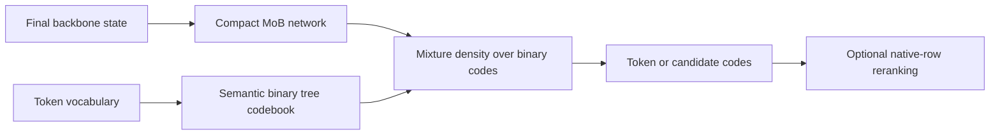

# MoB_Head

**Compact language-model output heads over semantic binary codes.**

[](LICENSE)
[](docs/03-cfhead-comparison.md)

MoB_Head replaces a language model's vocabulary projection with a small
**Mixture-of-Bernoullis (MoB)** network. Tokens receive semantic binary codes;
the head predicts a density over those codes and decodes tokens directly or
proposes a small set for native-head reranking.

The completed study reaches performance close to **CFHead**, a training-free
coarse–fine output approximation, in several measured decoding settings.
At a budget of 32 candidates, MoB improves English/Chinese containment by
2.5/3.1 percentage points. The measured GPU/CPU offload head paths both take
about 4.4 ms. CFHead remains stronger at 256 candidates and in distribution
coverage, with no distillation cost.

**This repository is a completed research release.** It contains implementations,
technical reports, numerical results and pretrained head artifacts.

## Results at a glance

| Experiment | Recorded result |
|---|---|
| Qwen3.5-2B, 32 candidates | MoB/CFHead-T4 containment: EN **96.67/94.15%**, ZH **94.20/91.14%** |
| Qwen3.5-2B, 256 candidates | CFHead-T4 exceeds exact MoB mixture containment by **0.6–2.2 points** across four sources |
| Offload head latency, RTX 4060 Laptop | MoB **4.400 ms**, CFHead **4.398 ms** |
| SmolLM2-1.7B, SwiGLU MoB | **1.78×** normalized native PPL; **96.5%** cascade agreement with 32 proposals |
| Llama-3.2-1B, MLP MoB | **2.00×** normalized native PPL after low-LR polish |
| Native pretraining, 212M backbone | **1.893×** MoB/native PPL at **0.49B tokens**, stable backbone training |

These rows use different protocols. The Qwen head is the fixed 224k-update
checkpoint; candidate-budget, density and downstream results are reported
separately in the [comparison study](docs/03-cfhead-comparison.md).
The pretraining experiment establishes trainability at the measured scale,
rather than quality parity or a convergence limit.

## Method



For $M=\lceil\log_2 V\rceil$, each token has a unique code $c(t)$.
The head predicts $K$ bit distributions and mixture weights:

$$q(c\mid h)=\sum_{k=1}^{K}\pi_k(h)\prod_{j=1}^{M}\operatorname{Bernoulli}(c_j;\sigma(z_{kj}(h))).$$

- **Semantic codebook:** two-means direction followed by a rank-balanced median
  split of the embedding table.
- **Exact distillation:** teacher-probability-weighted NLL on top-1024 support;
  no sampled targets or continuous target noise.
- **Compact architectures:** MLP, residual MLP and pre-normalized SwiGLU heads.
- **Decode family:** component rounding, exact mixture ranking, uncertain-bit
  proposals and optional native-row reranking.

The code-space distribution is normalized over all binary vertices. Perplexity
restricts and renormalizes it over valid vocabulary codes. Exact code ranking
and likelihood evaluation still have vocabulary-dependent work. Cascade mode
uses original output rows; pure code decoding does not.

## Models

Each artifact contains fp32 safetensors, constructor configuration, the exact
codebook, checksums and a model card. Backbone and tokenizer files are separate.

| Head | Backbone | Density PPL ratio | Model artifact |
|---|---|---:|---|
| SwiGLU, K=128, M=18 | Qwen3.5-2B | 1.47–3.66× by source | [Hugging Face](https://huggingface.co/ryan1145/mob-qwen3.5-2b-swiglu) |
| SwiGLU, K=128, M=16 | SmolLM2-1.7B | **1.78×** | [Hugging Face](https://huggingface.co/ryan1145/mob-smollm2-1.7b-swiglu) |
| ResMLP, K=128, M=16 | SmolLM2-1.7B | 1.90× | [Hugging Face](https://huggingface.co/ryan1145/mob-smollm2-1.7b-resmlp) |
| MLP, K=128, M=16 | SmolLM2-1.7B | 2.41× | [Hugging Face](https://huggingface.co/ryan1145/mob-smollm2-1.7b-mlp) |
| MLP, K=128, M=17 | Llama-3.2-1B | 2.00× | [Hugging Face](https://huggingface.co/ryan1145/Llama-MoB-3.2-1B-MLP) |

## Loading

```bash
git clone https://github.com/ryan-he-47/MoB_Head.git
cd MoB_Head
python -m pip install -r requirements.txt
```

```python
import torch
from mob.hub import load_head

head, codebook, config = load_head("ryan1145/mob-smollm2-1.7b-swiglu")
h = torch.zeros(1, config["head_kwargs"]["h"])
bit_logits, mixture_logits = head(h)
```

`h` must come from the matching backbone's final normalized output-head input.
The zero-state example verifies shapes, not language generation. These artifacts
are output heads, not complete `AutoModelForCausalLM` models. See
[reproduction and loading](docs/05-reproduction.md) for data, training and evaluation.

## Technical reports

1. [Semantic codes and mixture density heads](docs/01-method.md)
2. [Distillation, architecture and efficiency](docs/02-distillation.md)
3. [Comparison with CFHead](docs/03-cfhead-comparison.md)
4. [Native pretraining and architectural viability](docs/04-native-pretraining.md)
5. [Reproduction and model artifacts](docs/05-reproduction.md)

## Repository

```text
mob/       heads, density math, decoding and artifact loading
train/     frozen distillation, paired heads, adaptation and native pretraining
eval/      likelihood, fidelity, generation and efficiency evaluation
tools/     codebook/data construction and checkpoint publication
slurm/     cluster reproduction templates
data/      semantic codebooks
results/   aggregate numerical measurements
release/   model manifest, licenses and publication records
docs/      technical reports
```

All entry points run as modules from the repository root. Weights and corpora
are not stored in Git. The completed comparison did not exceed CFHead's overall
accuracy–cost tradeoff; the project is archived with its measured findings.

## License and citation

Original code and documentation are released under [MIT](LICENSE). Source models,
data and optional baseline implementations retain their own terms; see
[third-party notices](THIRD_PARTY_NOTICES.md). The Llama-derived artifact is
separately labeled under Llama 3.2 terms. Built with Llama.

To cite this implementation:

```bibtex
@software{mob_head_2026,
  author = {{MoB\_Head contributors}},
  title = {MoB\_Head: Compact Language-Model Output Heads over Semantic Binary Codes},
  year = {2026},
  url = {https://github.com/ryan-he-47/MoB_Head}
}
```
