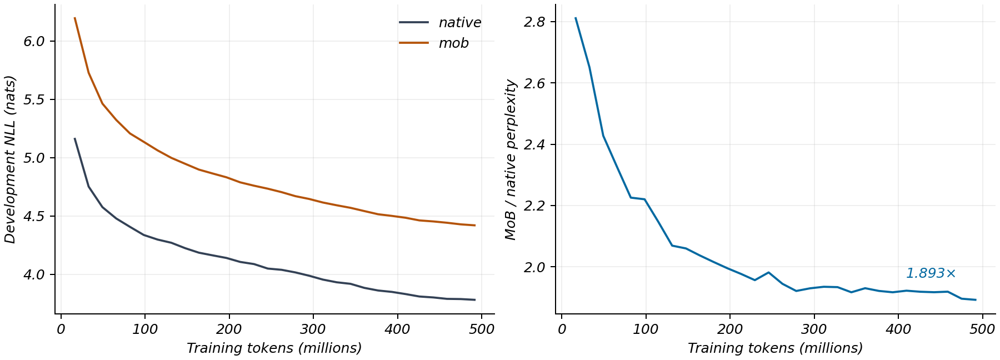

# Native Pretraining with a Mixture-of-Bernoullis Output Head

## Abstract

A controlled small-model pretraining experiment tests whether a semantic-code
mixture head can serve as the output layer while the backbone itself learns.
Paired Llama-style models are trained from random initialization on identical
token sequences. At 0.49B training tokens, the MoB/native perplexity ratio is
1.893, with no observed NaNs or dead mixture components. This establishes
end-to-end trainability at the tested scale; it does not establish native-head
quality parity or asymptotic convergence.

## 1. Experimental design

Both models use a Llama-style transformer with hidden dimension 768, 12 layers,
12 attention heads, intermediate width 3072, RMSNorm, RoPE, and the Llama-3.2
tokenizer with V=128,256. Backbone plus embedding parameters total approximately
212M. The native model uses tied input/output embeddings and softmax CE. The
MoB model adds an approximately 4.5M-parameter MLP head, width 922 and K=128,
predicting 17-bit semantic codes as its sole training output.

The MoB backbone is randomly initialized, but its fixed codebook comes from
pretrained Llama embeddings. Thus this experiment isolates output-head
trainability with a transferred semantic codebook; it is not a claim that
all components of the system were learned without pretrained information.

Training uses the same seed, FineWeb-Edu token order, batch 16, sequence length
512, and 60,000 updates. The consumed token budget is approximately 491.5M.
Because the output computations differ, equal tokens and updates do not imply
equal FLOPs or wall-clock time.

## 2. Optimization

Both models use fp32, AdamW with betas (0.9,0.95), weight decay 0.1, gradient
clipping at 1.0, and a cosine learning-rate schedule with peak 6e-4, 2% warmup,
and terminal learning rate 10% of peak. MoB adds mixture entropy regularization
0.01, frequency-weighted code initialization, and constant mixture temperature 1.
It optimizes target-code NLL without a teacher distribution.

Evaluation computes native CE and MoB likelihood normalized over valid token
codes on matched development data. Monitoring includes gradient norms, unused
vertex mass, effective component count, dead components, and finite losses.

## 3. Results

| Quantity | Native | MoB |
|---|---:|---:|
| Final development NLL | 3.7824 | 4.4204 |
| Training time | 16.9 h | 10.4 h |
| Approximate update time | 1.01 s | 0.63 s |
| Dead mixture components | — | 0 |
| Final effective components | — | 91.7 / 128 |
| Unused-code probability mass | — | 0.38% |

The perplexity ratio $\exp(4.4204-3.7824)=1.893$ narrows from approximately
2.81 early in training to 1.89 at the matched endpoint. No NaNs were recorded.

The measured 1.6× update speedup applies to these fp32 V100 runs. It should not
be generalized to larger models or different precision regimes. Qualitative
generation produces words and local syntax in both models; the MoB system
drifts more, consistent with its likelihood gap. Existing reranked generation
samples are diagnostic and do not replace the sole-head training result.

## 4. Interpretation

Gradients through a mixture of factorized code distributions train the backbone
stably. This is evidence for architectural viability, independent of the
frozen-backbone distillation results. Both models were still improving at the
recorded endpoint, so the measured ratio is a budget-specific result rather
than an irreducible cost of the architecture.
