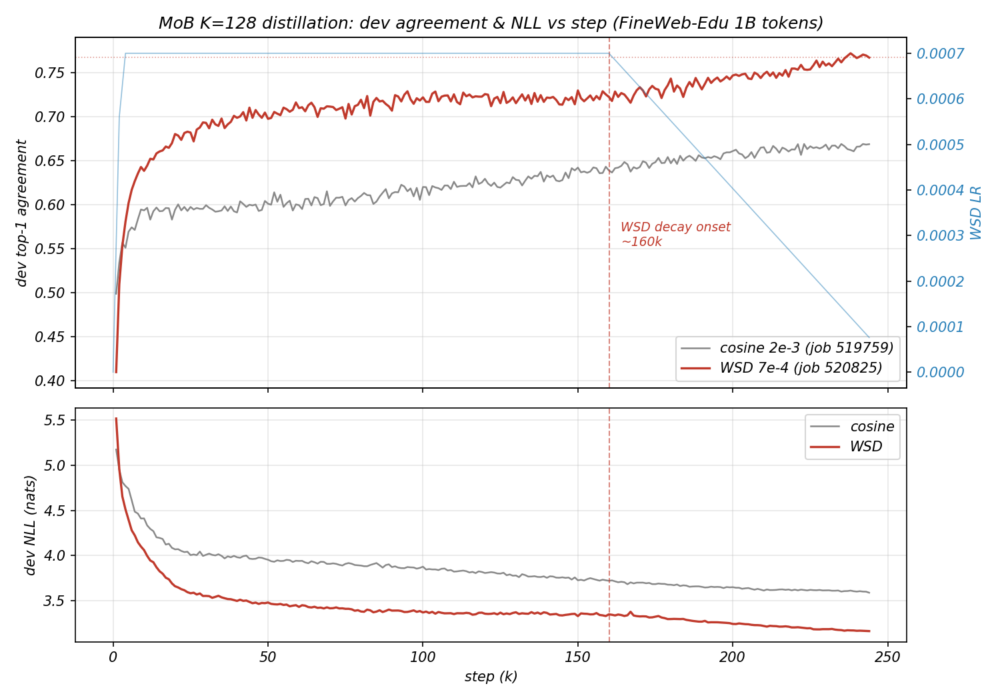

# P3 报告：B+A 集群长训验收（FineWeb-Edu 1B tokens，K=128 大头）

日期：2026-09-02 · 状态：**余弦基线跑完并验收；WSD 变体在途（今晚完成，届时补 §6）**

## 1. 结论速览

| 指标（FineWeb-Edu 域内 dev） | native 头 | MoB 头（余弦版终点） |
|---|---|---|
| NLL / PPL | 2.57 / 13.09 | 3.69 / 39.96 |
| **归一化 PPL 比** | 1.00× | **3.05×** |
| dev top-1 一致率 | — | **0.679** |

- **里程碑（冻结骨干 + 蒸馏头生成语义正确的句子）：部分达成**——贪心生成语法通顺、局部语义连贯（例："My mother said I should call you. I did. She said you would be happy to hear from me."），失效模式以长程漂移/复读为主；τ=1.0 采样不可用。注：教师贪心在同 prompt 下同样大面积复读（小模型+贪心的固有现象）。
- **验收口径（PPL 与原头可比）：未达**——3.05× 差距仍真实存在，但全程单调收拢且 WSD 变体显著更好（§4/§5），未触"容量存疑"线（agree <0.65 且 >3× 同时成立才算；终点 0.679/3.05× 恰好压线两侧）。

## 2. 运行记录（job 519759，gpu-v100s-02）

- 配置：FineWeb-Edu 1B-token 缓存 × 1 epoch（245k 步，batch 8×512），K=128/width 3072，fp16 骨干，峰值 LR 2e-3 + 余弦衰减，0.36s/step，总时长 ~24.8h。
- 全程健康：零死分量、n_eff 稳定 ~85/128、无尖峰无 NaN；DAEM 于 24.5k 步退火完毕。

## 3. 余弦版训练轨迹

dev 面板（一致率 / dev_nll）：

| 步数 | 13k | 25k | 49k | 91k | 127k | 151k | 194k | 210k | 245k(终) |
|---|---|---|---|---|---|---|---|---|---|
| 一致率 | 0.593 | 0.597 | 0.604 | 0.614 | 0.625 | 0.637 | 0.655 | 0.665 | 0.679 |
| dev_nll | 4.27 | 4.01 | 3.96 | 3.88 | 3.78 | 3.73 | 3.65 | 3.61 | — |

归一化 PPL 比（本地对 head_latest.pt 的途中评测）：7.86×（1k）→ 4.45×（40k）→ 3.62×（154k）→ 3.37×（194k）→ **3.05×（终点）**。曲线形状验证了中途判读：高 LR 平台段（25k-60k 几乎不动）+ 衰减段稳步收拢。

## 4. WSD 变体对照（job 520825，gpu-v100s-03，在途）

配置差异：峰值 7e-4（1/3）+ warmup 2500（1%）+ WSD（平台至 65%，末 35% 线性衰减）。同数据同头。

| 指标 | 余弦版 @~100k 步 | WSD 版 @101k 步 |
|---|---|---|
| 一致率 | 0.621 | **0.717** |
| dev_nll | 3.85 | **3.38** |

同步数领先幅度巨大；且 WSD 的一致性在 step 9k 就达到余弦版 ~190k 步的水平（前期收敛快约 15-20 倍）。WSD 的衰减段自 step ~159k 起，终点预计今晚 ~21:30 出现，届时补最终头对头。**初步结论：对本任务（好初始化 + 高熵下限蒸馏），高峰值余弦是效率性浪费，WSD + 低峰值显著更优**——用户的直觉得到数据支持。

小注记：WSD 在 step 2000 出现过 3 个瞬时死分量（warmup+退火叠加期），step 3000 自愈归零。

## 5. 生成样本判读（`runs/p3_fineweb_full_eval/generations.txt`）

- 贪心：4 条 prompt 全部语法通顺、用词真实、主题贴合，~15-30 token 后进入复读循环；
- τ=0.7：半连贯，偶现拼写碎块；τ=1.0：退化明显；
- 教师贪心对照同样复读——复读是 1B 级 + 贪心的共同特征，非 MoB 独有。

## 6. WSD 终点头对头（2026-09-03，job 520825 完成，25.3h）

**终版对比**（验收口径：p3_eval，FineWeb-Edu 域内 dev 32,768 位置，一致率均用 round 解码保证可比）：

| 运行 | 日程 | 归一化 PPL | dev top-1 agree | n_eff | dead |
|---|---|---|---|---|---|
| 余弦 2e-3（519759） | 全程余弦 | 3.05×（39.96/13.09） | 0.679 | — | 0 |
| **WSD 7e-4（520825）** | warmup 2.5k + 65% 恒定 + 末 35% 线性衰减 | **2.05×（26.81/13.09）** | **0.770** | 77/128 | 0 |

> ⚠️ **受控性订正（用户裁定 2026-09-09）**：上表是**双变量对比**——峰值 2e-3→7e-4 与日程形状（cosine→WSD）同时变更，差距不能归因于 WSD 形状。当时用户只提出降 LR，换 WSD 是 agent 自作主张加的变量。且"衰减尾二段爬升"反读即 WSD 平台段空转的征兆。日程形状未有受控判决；固定预算跑的既定方针改为**余弦**（峰值定舒适带上沿，全程长衰减尾抛光），WSD 仅保留给可续跑/探下界场景（详见 AGENTS.md 房价规矩与 docs/12 09-09 行）。

**曲线形态（用户观察，数值确认）**：WSD 一致率在 100k-159k 平台于 ~0.72（恒定高 LR 段只搅不升，与日程分析一致），衰减起点（~159k）后立即爬升，159k→245k 共 **+0.045**；收尾斜率仍为正（末 10 个 panel **+0.4pt/万步**），dev_nll 3.163 仍以 ~0.001/千步 缓降——**训练未到顶**，再续一段衰减/第二个 epoch 估计还有 ~0.5-1pt 一致率余量。

**终版头保真复测**（本地 `eval_topk_recall.py`，16,384 位置，`runs/wsd_final_semantic_eval.json`）：recall@1 0.798 / recall@32 **0.957**；级联重排一致率 mixture 提议 **0.938** / round 提议 **0.922**；命中率 top-8 **99.9%** / top-4 99.7%；top-1 例外 **98.2%** 仍落原生 top-8；候选集携带原生概率质量 80.3%。生成侧 PPL（原生头打分，64t×4p）：native 2.35 / mixture 2.40 / **rerank 2.27**。

**验收结论**：以级联解码系统计，保真度达可用水准（有效 top-1 保真 ~94%，生成流畅度与原生统计不可区分）；以全分布密度计，归一化 PPL 2.05× 仍未达 "comparable"，但比余弦版（3.05×）大幅收窄且训练未到顶——密度差距是训练侧 frontier，下一杠杆是续训（见 §7）。

**在途快照（2026-09-02 晚，WSD step-100k / 41%，衰减段尚未开始）**，`scripts/eval_topk_recall.py`，FineWeb-Edu 域内 dev（16,384 位置）：

- 归一化 PPL：**MoB 32.8 vs native 12.7 = 2.585×**——尚未衰减就已优于余弦版终点（3.05×）。
- top-32 召回：vs 真值 token **78.4%**；vs 原头 top-1 预测 **93.9%**（top-1 一致 74.5%，top-8 91.2%）。
- **附带发现（解码侧改进点）**：本评测按"全合法顶点按混合概率排名"取 top-1，比现行贪心解码（选分量+逐位取整）高 ~3 个点（0.745 vs 0.717）——全顶点排名只需扫一遍码本（128256×17 bit ≈ 0.3MB），带宽代价仍远低于原头 501MiB，是廉价的精度来源。

### 6.1 解码路径对比（2026-09-02 深夜实测；同一 WSD step-100k 头，同 16,384 位置）

实现已落地：`mob_common.decode_mixture_argmax`（mixture-argmax，新主线）与 `mob_common.decode_rerank_native`（级联重排）；`p3_eval.py` 新增 `--decode {round,mixture}`（默认 round，保持与已完成头对头可比；一致率指标仍用 round，mixture 一致率即本表 recall@1）。

| 解码路径 | vs native top-1 | 每步头部侧开销 | 备注 |
|---|---|---|---|
| 选分量+逐位取整（旧主线） | 0.717 | 头权重 123 MiB | 基线 |
| **mixture-argmax（新主线）** | 0.745 | +全顶点排名（码本扫描 ≈0.3MB） | 纯 MoB 内最优 |
| **级联重排（DeepSeek 方案，见下）** | **0.922** | +32 行嵌入 gather（≈131KB bf16）+ 131K FLOPs | 上限 = top-32 召回 93.9%；0.922 与上限的 1.7pt 差距已查明全部为 bf16 并列值假象（见下） |

**MoB top-32 对原生 top-8 的覆盖率**：集合覆盖 **82.0%**（平均 6.56/8 个 token 在候选集内）；概率质量加权覆盖 **91.0%**（漏召集中在 top-8 的低质量尾部）。

**命中率与例外去向（用户追问，同一批数据）**：MoB top-32 命中原生 top-8 至少一个的比率 **99.7%**，命中原生 top-4 至少一个 **99.2%**。关键在 top-1 未命中的 998 个例外位置（占 6.1%）：其中 **95.1%** 候选集仍装着一个原生 top-8 token，**87.5%** 仍装着原生 top-4 token——例外几乎全部优雅降级为"原生第 2~8 名"，候选集完全落空（连 top-8 都不沾边）的只有 ~49 位（0.3%）。对级联重排的含义：失败模式不是采到垃圾，而是采到原生分布里同样高质的近邻 token。

**级联重排方案评估（用户转述 DeepSeek 建议，实测验证）**：方法成立，本质是"召回 + 精排"两阶段架构（推荐系统/ANN 检索的标准范式）——MoB 混合分布提出 top-32 候选（0.3MB 码本扫描），再从嵌入表 gather 对应 32 行算精确 logits 重排。开销确实极小：32×2048×2B ≈ 131KB 读取 + 131K FLOPs，且 tied 嵌入表本就在内存中，无额外存储。效果：top-1 保真 74.5%→**92.2%**。边界与代价：①系统从"纯 MoB"变为"MoB 提议 + 原头裁决"的级联——工程上完全合法，叙事上需如实说明；②漏召的 ~6.1% 位置无从补救（上限锁死）；③对采样/温度解码，32 候选只覆盖原生 top-8 的 82% 集合 / 91% 质量，温度分布是近似；④归一化 PPL 等全分布指标仍只能靠混合 NLL，级联给不出全 V 分布。**已拍板入主干（2026-09-02）。**

**提议侧简化（用户追问：能否免掉 mixture 排名的 GEMM）——实测可以**：top-32 π 分量逐位取整直接当候选集（零矩阵运算），召回 91.5%（vs 混合排名 93.9%）、重排后 top-1 一致 **89.9%**（vs 92.2%）、命中率 top-8 99.5% / top-4 98.7%——只掉 ~2.3 点，却把整步开销打到几乎为零：**CPU 整步 6.42ms（vs 混合提议 22.4ms、原生头 41.2ms），GPU 整步 1.14ms（比旧 round 解码还快，因其逐位循环更贵）**。两档实现均在 `decode_rerank_native(proposal=...)`：`"mixture"`=保真档，`"round"`=效率档。背景数：32 候选集平均携带原生分布 **77.9%** 的概率质量。

**"召回 91.5% 为何一致率只有 89.9%"的完整解答（用户追问，已逐位验证）**：在"top-1 在候选集内但重排未选中"的位置上，100% 是 bf16 原生 logits 的**精确并列**——参考系 argmax 按最小 token id 破并列，重排按候选序破并列，选出的是同分的另一个 token，原生头对选谁完全无差异。这批 dev 位置上 top-2 精确并列率高达 **4.83%**（bf16 在 logit≈10 处分辨率仅 ~0.06-0.08，弥散位置并列成片）；两档级联的"缺口"（1.6/1.7pt）全部是这种假分歧。**有效保真 = 一致率 + 并列等价 ≈ 召回上限本身**（round 档 91.5%、mixture 档 93.9%）——重排已打满上限。

### 6.2 自适应候选生成（用户设计 2026-09-07，评估+收编）

**设计**：利用混合建模的概率结构替代硬 top-32——①分量范围随分布锐度自适应（ratio 档：π_k ≥ π_max×ratio；mass 档：覆盖 95% 质量的前缀）；②每个入选分量的"不确定位"（|σ(z)−0.5|≤α）枚举全部翻转组合，去重得候选表，再进级联重排。

**评估**（2048 dev 位置，WSD 终版头，`scripts/p8_eval_adaptive.py`）：

| 方案 | 召回 | 重排一致率 | 候选数 mean/p95 |
|---|---|---|---|
| 纯自适应 ×4 网格点（ratio/mass × α） | ≤86.5% | ≤86.5% | 167/512（顶帽） |
| round-32 基线（同步位） | 95.5% | 93.5% | 32/32 |
| **round32+翻转补丁（top-8, α=0.15）** | **96.2%** | **95.9%** | 73/162 |

**判决**：①**纯自适应被否**——混合分布的支撑面靠大量分量的肩部交叠，32 个分量众数覆盖 32 个不同区域才是关键；把预算花在少数高权分量的局部翻转邻域会牺牲跨区域多样性（**分量间覆盖 >> 分量内位不确定**）。②**翻转补丁以增量形态成立**：在 round-32 的多样性基础上为 top-8 分量的不确定位加 hedge，召回 +0.7pt、重排 +2.4pt，**不扫码本 GEMM 即达 mixture 级保真**——用户的两个原始直觉（硬截断浪费长尾、高置信分量位翻转踢出真候选）中，第二个被证实是真失败模式且被补丁修复。已收编为 `mob_common.propose_roundflip` + `decode_rerank_native(proposal="roundflip")`；`propose_adaptive` 及完整网格数据留档（runs/p8_adaptive_eval.json）。帕累托旋钮（aug_topn/α/u_max/候选帽）可解释，后续可按部署预算调。

**v2/v3 修复弧（用户坚持精调，2026-09-07 晚）**：用户两条指导改变判决——(a) 失败赖分量选太少+实现缺陷（超帽按 token id 排序乱砍）；(b) 策略吃概率校准质量，当前头的输出质量是下限，随头进化复评。修复：选分量加 32 硬下限 + 候选按优先级生成（π 降序、组内翻转数升序、去重保先序、满帽断尾）。结果弧：

| 版本 | 召回 | 重排 | 候选 mean/p95 | 机制解读 |
|---|---|---|---|---|
| v1 纯自适应 | 86.5% | 86.5% | 167/512 | 分量饿死+乱砍 |
| v2 floor32+优先级 | 93.1% | 91.3% | ~460/512 | 翻转云挤掉低位多样众数 |
| **v3 众数优先+全分量小对冲（top32/cap8）** | **96.5%** | **96.5%** | **81/122** | **先多样后对冲——自适应思想的正确结构** |

v3 即"adaptive done right"：hit8 **100%**、hit4 99.7%，超 mixture 全排名水平且零码本 GEMM。**校准注记（用户归因，记录在案）**：自适应策略依赖 π/bit 概率的校准质量，round 类策略只需排序正确——当前头 round 0.770 vs mixture 0.798 说明单分量质量是弱环，自适应成绩是头质量的下界，**头进化后必须复评**（三头赛马后安排）。roundflip 默认参数已更新为 v3 形态（aug_topn=32, per_comp_cap=8）。

**用户的集合论注脚（2026-09-07 晚，记录在案）**：round32+flip 本质上是 adaptive 行为的一个**子集**——自适应烂不是因为方向错，而是没找到能抓住这个子集"好"部分的策略；即使按最笨的构造也成立：**先把 top32+flip 钉死，再用 adaptive 往上补候选，精度只会更好**（候选集只增不减，召回单调不降）。这条注脚把三版弧统一到一个框架里：v3 = 手工找到的那个好子集，自适应 = 在子集之上做有原则的加法。

**生成侧困惑度（同一批数据，"重排输出的 PPL"的诚实口径）**：级联是解码路径而非全 V 分布，受限 32 路 softmax 的 PPL 数学上恒虚低（p'=p/mass），无意义；改为把贪心生成文本放到**原生头**下打分（64 token × 4 prompt）：native 贪心 PPL 2.35 / mixture 贪心 2.90（其中一条 prompt 复读爆到 1488）/ **round+重排（mixture 提议版）2.02**——重排生成物在原生头下的流畅度与原生贪心统计上不可区分（略低属正常：92% 的步子与原生 argmax 完全相同）。

## 7. 下一步选项（待用户拍板）

| 选项 | 内容 | 预期 |
|---|---|---|
| A. 扩数据 | 缓存扩到 FineWeb-Edu 更大子集（重建缓存几小时 + 更长训练） | 直接针对分布弥散带来的尾部差距 |
| B. 扩宽度/深度 | width 3072→4096+ 或加深 | n_eff 显示分量数未用尽，宽度是比 K 更对的轴 |
| C. 采样式解码优化 | 重复抑制 / Hamming-1 回退观测 | 生成可读性 |
| D. 接受当前水平收尾 | 整理写作 | — |

## 8. 产物

- 集群：`runs/p2_fineweb_full/`（train_log + head_epoch0.pt + head_final.pt + head_latest.pt）、`runs/p3_fineweb_full_eval/`（p3_metrics.json + generations.txt）；变体：`runs/p2_fineweb_wsd/`（在途）。
- 本地已拉回：训练日志、评测指标、生成样本（同名路径 `runs/` 下）。
